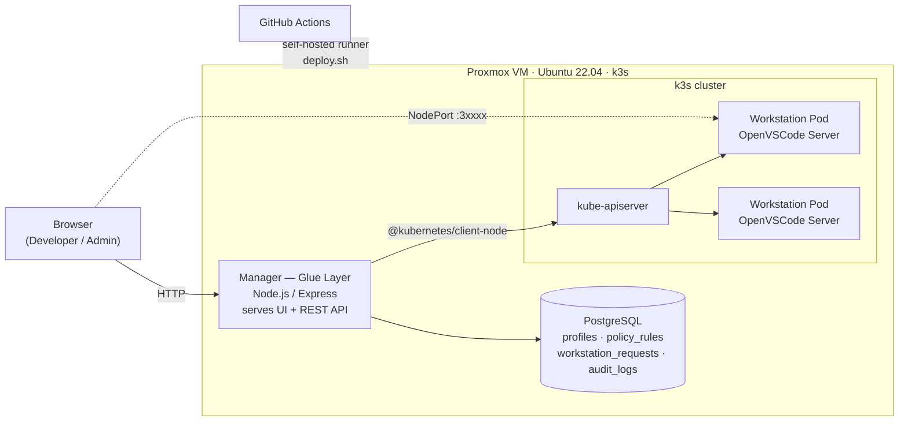

# Compliance & Auto-Remediation for On-Demand Cloud-Native Workstations

> Diploma thesis project — a self-service platform that provisions browser-based development workstations on Kubernetes and (by design) checks every provisioning stage against an ISO/IEC 27001 Annex A.8 / CIS Benchmark policy set, remediating violations automatically before the workstation reaches the user.


---

## The problem

Cloud development environments (Gitpod, GitHub Codespaces, self-hosted VS Code) are created on demand, often from images and manifests nobody re-checks. Hardening is usually manual, inconsistent across teams, and silently drifts. This project explores a **"compliant by construction"** approach: a glue layer that sits between the user's request and the cluster, evaluates each stage of workstation creation against a configurable policy set and fixes what it can — producing a known-good workstation plus an audit trail that can be shown to an auditor.

## What it does today

- **Self-service portal** — a developer picks a profile (Software Developer, Data Analyst, DevOps / Cloud Security) and gets a running [OpenVSCode Server](https://github.com/gitpod-io/openvscode-server) in the browser.
- **Authentication & role-based access** — accounts are created by an admin; passwords are hashed with scrypt, sessions use `HttpOnly` / `SameSite=Strict` cookies (only a SHA-256 of the token is stored), first login forces a password change and repeated failed logins are throttled. Every API call is authorised server-side: developers see only their own workstations, admins get the dashboard.
- **Approval workflow** — developer requests wait in a *Notifications* tab (highlighted in red with a live counter) until an admin accepts or rejects them with a reason; admin requests are auto-approved. Each decision is recorded with the reviewer.
- **Per-workstation access token** — each VS Code instance starts with a random connection token delivered through a Kubernetes Secret, so the NodePort URL is useless without the owner's link.
- **Real provisioning on Kubernetes (k3s)** — the Manager creates a Pod and a NodePort Service, waits until the Pod is actually *Ready*, and only then returns the access URL.
- **Failure handling** — image or startup failures (e.g. `ErrImageNeverPull`) are detected, the Pod/Service are cleaned up and the request is marked `FAILED` with the reason.
- **Lifecycle & reconciliation** — workstations can be terminated from the admin dashboard; the database is reconciled with the real cluster state so the UI never shows Pods that no longer exist.
- **Time-limited sessions** — every workstation expires after a configurable time (default **10 hours**). A session sweeper in the Manager deletes expired Pods and logs the event; `activeDeadlineSeconds` on the Pod acts as a Kubernetes-level safety net even if the Manager is down.
- **Admin dashboard** — policy checklist (ON/OFF per rule and profile), workstation overview with history, and a compliance **audit trail** stored as JSON in PostgreSQL, exportable **per day as JSON or CSV**.
- **Operations** — nightly PostgreSQL backups plus an automatic export of the previous day's audit trail, and a Trivy-based vulnerability report for every workstation image.
- **Continuous deployment** — every push to `main` is deployed to the lab VM by a self-hosted GitHub Actions runner, with fail-fast scripting, automatic rebuild/import of missing images and a post-deploy health check.

> **Note:** in the current phase the generated workstation manifests are **intentionally un-hardened**. They form the *baseline* against which the auto-remediation engine (next phase) is measured — before/after comparisons are part of the evaluation.

## Architecture



### Provisioning pipeline (inside the Manager)

```
Request ─► 1. Image Validation ─► 2. Manifest Generation ─► 3. Admission Gate ─► 4. Deploy ─► 5. Readiness ─► Audit log
              (Trivy — planned)      (remediation — planned)   (Kyverno/OPA — planned)  (k3s)       (Pod Ready)     (PostgreSQL)
```

Each stage logs its progress (`[LOG] Step N: …`) and writes to the audit trail. Stages 1–3 are wired in as placeholders today and become real checks in Phase 2.

## Tech stack

| Layer | Technology |
|---|---|
| Infrastructure | Proxmox VE, Ubuntu Server 22.04 LTS, k3s (lightweight Kubernetes), containerd |
| Workstations | OpenVSCode Server (Gitpod) on a shared Ubuntu base image, one image per profile |
| Manager / API | Node.js 20, Express 5, `@kubernetes/client-node`, `pg` |
| Frontend | Vanilla HTML / CSS / JavaScript served by the Manager |
| Database | PostgreSQL 15 (Docker Compose) |
| CI/CD | GitHub Actions with a self-hosted runner, PM2 process manager |
| Compliance (planned) | Trivy, Kyverno / OPA Gatekeeper, ISO/IEC 27001 Annex A.8, CIS Docker & Kubernetes Benchmarks |

## Workstation profiles

All profiles inherit from `workstation-base:v1` (OpenVSCode Server, non-root `USER 1000`, minimal packages). Separate images keep the attack surface and image size small (least privilege).

| Profile | Image | Main tooling | Planned resources | Key controls |
|---|---|---|---|---|
| Software Developer | `workstation-profile:developer` | Node.js, Python 3, Go, build-essential | 1 vCPU / 1 GiB | A.8.6, A.8.9, A.8.20, A.8.22, A.8.28 · CIS Docker 4.1 |
| Data Analyst | `workstation-profile:data-analyst` | Python, JupyterLab, pandas, NumPy, scikit-learn, psql, sqlite3 | 2 vCPU / 4 GiB | A.8.2, A.8.6, A.8.12, A.8.31 · read-only root FS |
| DevOps / Cloud Security | `workstation-profile:devops` | kubectl, Trivy | 1 vCPU / 2 GiB | A.8.2, A.8.3, A.8.7, A.8.8 · CIS Kubernetes 5.1 / 5.2 |

## Repository structure

```
.
├── .github/workflows/deploy.yml   # CD: runs deploy.sh on the self-hosted runner on every push to main
├── INSTALL.md                     # step-by-step installation guide (Greek)
├── deploy.sh                      # pull → npm ci → pm2 restart → build/import missing images → health check
├── deploy/runner-sudoers          # least-privilege sudo rule for the CI runner (docker + k3s only)
├── database/
│   ├── docker-compose.yml         # PostgreSQL 15 (credentials from database/.env)
│   ├── migrations/                # versioned schema changes, applied by the Manager on startup
│   ├── .env.example
│   ├── init.sql                   # schema + the three workstation profiles
│   ├── backup.sh                  # pg_dump + previous day's audit export, 14-day retention
│   └── thesis-db-backup.cron      # nightly schedule (/etc/cron.d)
├── docker/
│   ├── Dockerfile.base            # OpenVSCode Server (pinned version + digest) + non-root user
│   ├── Dockerfile.developer
│   ├── Dockerfile.data-analyst
│   ├── Dockerfile.devops
│   └── scan-images.sh             # Trivy vulnerability reports (optional 0 Critical / 0 High gate)
└── manager/                       # Glue layer (Node.js)
    ├── server.js                  # REST API, access control per endpoint, pages
    ├── auth.js                    # password hashing, sessions, role checks, login throttling
    ├── migrate.js                 # applies database/migrations/*.sql
    ├── scripts/create-admin.js    # bootstrap the first admin account
    ├── workstations.js            # provisioning pipeline, readiness, cleanup, termination, reconciliation
    ├── k8s.js                     # Kubernetes client (kubeconfig)
    ├── db.js                      # PostgreSQL pool
    ├── .env.example
    └── public/
        ├── login.html             # Login + forced password change
        ├── index.html             # Developer portal (requests, my workstations)
        └── admin.html             # Admin dashboard (notifications, workstations, users, policies, audit trail)
```

## Getting started

> 📘 **Full step-by-step installation guide (Greek):** [INSTALL.md](INSTALL.md) — from creating the Proxmox VM to GitHub Actions, backups and troubleshooting.

Quick start for an existing host. **Prerequisites:** a Linux host with [k3s](https://k3s.io), Docker (with Compose), Node.js ≥ 20.19 and PM2.

```bash
# 1. Database
cd database
cp .env.example .env              # set POSTGRES_PASSWORD
docker-compose up -d

# 2. Workstation images (built locally, imported into k3s' containerd)
cd ../docker
docker build -f Dockerfile.base         -t workstation-base:v1 .
docker build -f Dockerfile.developer    -t workstation-profile:developer .
docker build -f Dockerfile.data-analyst -t workstation-profile:data-analyst .
docker build -f Dockerfile.devops       -t workstation-profile:devops .
for p in developer data-analyst devops; do
  docker save workstation-profile:$p | sudo k3s ctr -n k8s.io images import -
done

# 3. Manager
cd ../manager
cp .env.example .env              # DB credentials, K8S_NAMESPACE, optional PUBLIC_HOST
npm ci --omit=dev
pm2 start server.js --name manager
node scripts/create-admin.js --email you@example.com --name "Your Name" --username admin   # prints a temporary password
```

Then log in at `http://<host>:5000/login` (you will be asked to set your own password); admins land on `/admin`, developers on the portal.
After the first setup, `deploy.sh` keeps everything up to date — including rebuilding any image that has gone missing.

## REST API

All endpoints except `/api/health` and `/api/auth/login` require a session cookie; authorisation is enforced server-side.

| Method | Endpoint | Access | Description |
|---|---|---|---|
| `GET` | `/api/health` | public | Liveness check |
| `POST` | `/api/auth/login` | public | Log in `{ email, password }` (throttled after 5 failures) |
| `POST` | `/api/auth/logout` | user | End the session |
| `GET` | `/api/auth/me` | user | Current user |
| `POST` | `/api/auth/change-password` | user | `{ current_password, new_password }` |
| `GET` | `/api/profiles` | user | Available workstation profiles |
| `POST` | `/api/workstations/request` | user | Request a workstation `{ profile_id }` (admin: auto-approved) |
| `GET` | `/api/my/workstations` | user | The caller's workstations (with tokenized link when running) |
| `DELETE` | `/api/workstations/:id` | owner / admin | Terminate a workstation (Pod + Service + Secret) or cancel a waiting request |
| `GET` | `/api/approvals`, `/api/approvals/count` | admin | Requests waiting for approval |
| `POST` | `/api/workstations/:id/approve` | admin | Approve and start provisioning |
| `POST` | `/api/workstations/:id/reject` | admin | Reject `{ note }` |
| `GET` | `/api/workstations` | admin | All workstations (reconciled with the cluster) |
| `GET` `POST` `PATCH` | `/api/users`, `/api/users/:id` | admin | List / create (temporary password) / change role or activate |
| `POST` | `/api/users/:id/reset-password` | admin | Issue a new temporary password |
| `GET` | `/api/policies` · `POST` `/api/policies/toggle` | admin | Policy checklist |
| `GET` | `/api/audit-logs` | admin | Compliance audit trail (with actor) |
| `GET` | `/api/audit-logs/export?date=YYYY-MM-DD&format=json|csv` | admin | Download one day of audit records (day computed in `REPORT_TIMEZONE`) |

## Operations

```bash
# Least-privilege sudo for the CI runner (lets deploy.sh build/import images)
sudo visudo -c -f deploy/runner-sudoers && sudo install -m 0440 deploy/runner-sudoers /etc/sudoers.d/github-runner

# Nightly backups (02:00) → /var/backups/thesis-db, log in /var/log/thesis-db-backup.log
sudo cp database/thesis-db-backup.cron /etc/cron.d/thesis-db-backup
sudo bash database/backup.sh                        # run once now

# Restore a backup (into an empty database)
gunzip -c /var/backups/thesis-db/thesis-db_<stamp>.sql.gz | sudo docker exec -i thesis-postgres psql -U thesis_admin -d thesis_workstations_db

# Vulnerability reports for all workstation images → reports/<date>/
bash docker/scan-images.sh            # report only
bash docker/scan-images.sh --gate     # fail on any CRITICAL/HIGH finding
```

Configuration (`manager/.env`): `SESSION_TTL_HOURS` (default `10`), `REPORT_TIMEZONE` (default `Europe/Athens`), `PUBLIC_HOST`, `POD_READY_TIMEOUT_MS` — see `manager/.env.example`.

## Roadmap

- [x] **Infrastructure** — Proxmox VM, k3s cluster
- [x] **Images** — non-root base image pinned by version and digest + three profile images
- [x] **Pre-baked compliance evidence** — Trivy vulnerability reports per image
- [x] **Manager & database** — Express API, PostgreSQL schema, Kubernetes client
- [x] **Real provisioning** — Pod + NodePort Service, readiness wait, failure cleanup, termination, reconciliation
- [x] **Sessions** — 10-hour workstation lifetime enforced by the Manager and by Kubernetes
- [x] **Access control** — login, admin/developer roles, approval workflow with notifications, user management, per-workstation VS Code tokens
- [x] **Schema migrations** — versioned SQL migrations applied automatically on startup
- [x] **UI** — developer portal and admin dashboard with daily audit export
- [x] **CI/CD** — self-hosted runner, fail-fast deploy script, automatic image rebuild/import, health check
- [x] **Operations** — nightly database backups and audit archives, least-privilege runner permissions
- [ ] **Phase 2 — compliance engine**
  - [ ] Stage 1: image scanning with Trivy (0 Critical / 0 High gate)
  - [ ] Stage 2: manifest validation & auto-remediation (securityContext, non-root, read-only root FS, dropped capabilities, resource limits, NetworkPolicies)
  - [ ] Stage 3: admission gate (Kyverno or OPA Gatekeeper)
  - [ ] Stage 4: bootstrap verification
  - [ ] Live remediation status in the UI and structured JSON audit evidence
- [ ] **Phase 3** — profile-specific policies, dedicated namespaces and RBAC per workstation
- [ ] **Cloud migration** — the same manifests on a managed Kubernetes service, with on-prem vs. cloud comparison
- [ ] **Future work** — runtime drift detection (e.g. Falco / eBPF)

## Lessons learned from operating the lab

- **Disk pressure silently destroys local images.** With `imagePullPolicy: Never`, images live only in k3s' containerd. When the VM disk filled up, the kubelet's image garbage collector removed them and new Pods failed with `ErrImageNeverPull`. The deploy script now rebuilds/imports missing images and refuses to build above 80% disk usage.
- **A green pipeline is not a successful deployment.** The original deploy script had no `set -e`; `git pull` had been failing for weeks (a committed `node_modules` was modified by every `npm install`) while every run still reported success. The script now fails fast, uses `git pull --ff-only` and `npm ci`, and ends with a health check.
- **Self-hosted runners are removed after long offline periods**, so jobs stay *Queued* until the runner is registered again.
- **Mocks are not enough for SQL.** A query that passed mocked tests failed on PostgreSQL (`inconsistent types deduced for parameter`) — database logic needs to be tested against a real instance.

## Security notes

- No credentials are stored in this repository; configuration lives in untracked `.env` files (see the `.env.example` templates).
- Access control: scrypt password hashes, hashed session tokens in `HttpOnly` / `SameSite=Strict` cookies, forced password change on first login, login throttling, server-side role checks on every endpoint, pages not served as static files, no CORS.
- Every workstation requires its own connection token (Kubernetes Secret); links are only shown to the owner and to admins.
- Known gaps addressed in Phase 2: Pods are not yet hardened (securityContext, NetworkPolicies), traffic is plain HTTP inside the lab network, and the upstream OpenVSCode image grants the container user password-less `sudo`. Set `COOKIE_SECURE=true` when serving over HTTPS.

---

*Diploma thesis — "Compliance and Auto-Remediation in On-Demand Cloud-Native Workstations".*
